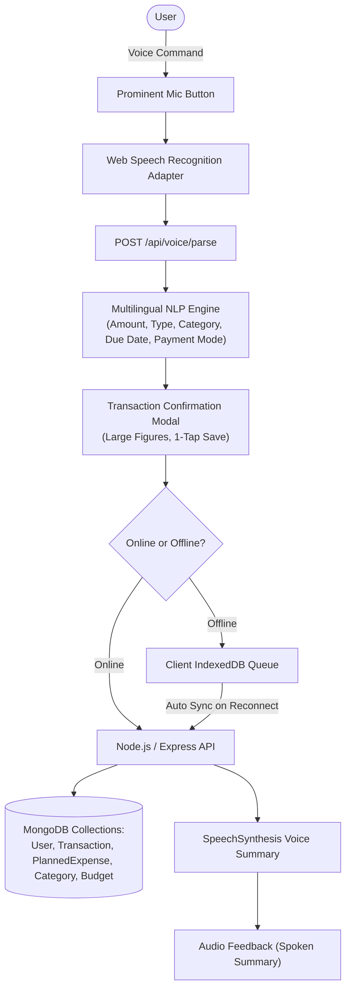

# BolKhata (बोल खाता) — Voice-First Expense & Income Tracker

> **Core Principle**: A user should be able to add an expense, check today's spending, and hear their financial summary without needing to understand complicated financial software.

BolKhata is a production-minded, mobile-first, voice-enabled expense and income tracking Progressive Web Application (PWA) built on the MERN stack. It is specifically designed with an extreme focus on simplicity and high accessibility for people with limited literacy and digital experience.

---

## Key Features

1. **Voice-First Expense & Income Entry**: Speak naturally in Hindi, Punjabi, or English (e.g. *"Aaj 200 rupaye sabzi pe kharch kiye"*, *"500 rupees petrol"*, *"Received 5000 salary"*).
2. **Mandatory Confirmation Before Saving**: Never auto-saves ambiguous speech. Visual confirmation displays amounts in large numbers with category icons and 1-tap confirmation.
3. **Audio Feedback & Summaries**: Integrated `SpeechSynthesis` audio player speaks daily financial summaries out loud (*"आज आपने 700 रुपये खर्च किए और 5000 रुपये कमाए"*).
4. **Offline Storage & Synchronization**: Fully works offline using IndexedDB via `idb`. Offline transactions are queued locally and automatically synced to MongoDB Atlas upon reconnecting.
5. **Planned Expenses & Due Dates**: Tracks upcoming bills (e.g. *"Kal 1000 rupaye bijli ka bill dena hai"*). Marking a bill as paid automatically creates a completed transaction record.
6. **Simple Monthly Budgets**: Visual spending meter with color-coded alerts (green, yellow, red over-budget warning).
7. **Filters & Analytics**: Easy 1-tap period filters: Today, Yesterday, This Week, and This Month, alongside category breakdowns.
8. **Undo Functionality**: Instant snackbar undo for accidentally deleted records.
9. **Export to CSV & PDF**: Generates downloadable CSV tables and branded PDF financial statements.
10. **Multilingual Interface**: 1-tap switching between Hindi (हिन्दी), Punjabi (ਪੰਜਾਬੀ), and English.

---

## System Architecture



---

## Technology Stack

- **Frontend**:
  - React.js 18 with Vite
  - Tailwind CSS with warm white `#FAF9F6` background & soft green `#10B981` brand palette
  - Redux Toolkit (auth, transactions, planned expenses, budget, UI states)
  - React Router v6
  - Lucide React icons
  - Recharts (accessible, non-overwhelming visual summaries)
  - IndexedDB (`idb`) for offline persistence
  - `vite-plugin-pwa` for Progressive Web App offline caching

- **Backend**:
  - Node.js & Express.js (ES Modules)
  - MongoDB & Mongoose
  - JWT Authentication & HTTP-only cookies
  - Custom Multilingual NLP Voice Parser
  - PDFKit for PDF statements
  - Node Test Runner (`node --test`)

---

## Supported Voice Command Examples

| Spoken Command | Extracted Type | Amount | Category | Payment Mode | Intent |
|---|---|---|---|---|---|
| *"Aaj 200 rupaye sabzi pe kharch kiye"* | Expense | ₹200 | Groceries & Sabzi | Cash | Add Transaction |
| *"500 rupees petrol"* | Expense | ₹500 | Petrol & Travel | Cash | Add Transaction |
| *"Received 5000 rupees salary"* | Income | ₹5000 | Salary & Wage | Bank | Add Transaction |
| *"GPay se 250 chai nashta"* | Expense | ₹250 | Food & Chai | UPI | Add Transaction |
| *"Kal 1000 rupaye bijli ka bill dena hai"* | Planned | ₹1000 | Bills & Recharge | UPI | Planned Bill |
| *"How much did I spend today?"* | Query | - | - | - | Spoken Summary |
| *"Show my expenses this week"* | Query | - | - | - | History Navigation |
| *"Aj 300 rupaye doodh te kharch kitte"* (Punjabi) | Expense | ₹300 | Groceries & Sabzi | Cash | Add Transaction |

---

## API Endpoints

### Authentication
- `POST /api/auth/register` — Register user with preferred language
- `POST /api/auth/login` — Login with identifier (phone or email) and password
- `POST /api/auth/logout` — Clear session cookie
- `GET /api/auth/me` — Fetch current user profile
- `PATCH /api/auth/me` — Update preferences (language, voice speed)

### Transactions
- `POST /api/transactions` — Create transaction
- `GET /api/transactions` — Query transactions (filters: `period=today|yesterday|week|month`, `type`, `search`)
- `GET /api/transactions/summary` — Get totals, category breakdown, and spoken TTS summary
- `POST /api/transactions/sync` — Batch sync offline queue from IndexedDB
- `GET /api/transactions/:id` — Get single transaction
- `PATCH /api/transactions/:id` — Update transaction
- `DELETE /api/transactions/:id` — Delete transaction

### Voice Processing
- `POST /api/voice/parse` — NLP parse of voice utterance into structured data & confirmation prompt

### Planned Expenses
- `POST /api/planned-expenses` — Create upcoming bill with due date
- `GET /api/planned-expenses` — List planned expenses (`status=pending|paid|all`)
- `PATCH /api/planned-expenses/:id` — Update or mark as paid (automatically creates completed expense record)
- `DELETE /api/planned-expenses/:id` — Delete planned bill

### Budgets
- `GET /api/budgets` — Get monthly budget status, spending meter, and over-budget alerts
- `POST /api/budgets` — Set/update monthly budget target

### Export
- `GET /api/export/csv` — Download CSV transaction history
- `GET /api/export/pdf` — Download branded PDF statement

---

## Quick Start & Running Locally

### 1. Prerequisites
- Node.js 18+
- MongoDB (local `mongod` or MongoDB Atlas URI)

### 2. Setup Backend
```bash
cd backend
npm install
# Set environment variables in backend/.env
PORT=5000
MONGODB_URI=mongodb://127.0.0.1:27017/bolkhata
JWT_SECRET=bolkhata-jwt-super-secret-key-2026
```

### 3. Seed Demo Data & Run Tests
```bash
# Seed initial categories & demo account:
node src/utils/seedData.js

# Run test suite:
npm test
```

### 4. Setup Frontend
```bash
cd ../frontend
npm install
npm run build
npm run dev
```

### 5. Demo Credentials
- Identifier: `demo@bolkhata.com`
- Password: `password123`
*(Or click "Quick Demo Login" on the Login screen for instant 1-tap access)*

